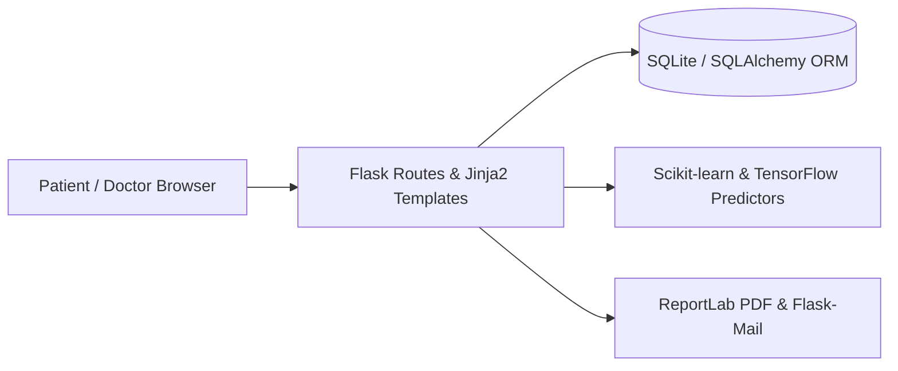

# CodeCure — AI-Assisted Healthcare & Symptom Prediction Web App

[](https://github.com/VaibhavBajpaij/CodeCure-Healthcare-Website-GFGXNIET)
[](https://github.com/VaibhavBajpaij/CodeCure-Healthcare-Website-GFGXNIET)
[](LICENSE)

**CodeCure** is a full-stack Python **Flask** and **SQLAlchemy** healthcare web application featuring patient/doctor appointment workflows, automated PDF prescription generation, health analytics with **Plotly**, and symptom-based disease prediction powered by **Scikit-learn** and **TensorFlow**.

---

## Key Features

- **Patient & Doctor Portals:** Registration, role-based views, session authentication, and appointment booking/status tracking via SQLite/SQLAlchemy.
- **Symptom-Based Disease Prediction:** Decision Tree classifier (`scikit-learn`) trained on 132 clinical symptom indicators returning predicted diagnosis and probability score.
- **Diagnostics & Medical Imaging Modules:** Dedicated endpoints for lung and cataract screening workflows (`TensorFlow / Keras`).
- **Prescription PDF Export & Mail Alerts:** Dynamic prescription PDF generation (`ReportLab`) and SMTP notifications (`Flask-Mail`).

---

## Architecture Overview



---

## Local Setup

```bash
git clone https://github.com/VaibhavBajpaij/CodeCure-Healthcare-Website-GFGXNIET.git
cd CodeCure-Healthcare-Website-GFGXNIET
python -m venv .venv
.venv\Scripts\activate
pip install -r requirements.txt
```

Create a `.env` file with `FLASK_SECRET_KEY`, `MAIL_SERVER`, `MAIL_USERNAME`, and `MAIL_PASSWORD`, then run:

```bash
python app.py
```

---

## Tech Stack

`Python` · `Flask` · `SQLAlchemy` · `SQLite` · `Scikit-learn` · `TensorFlow` · `Plotly` · `Pandas` · `ReportLab`
